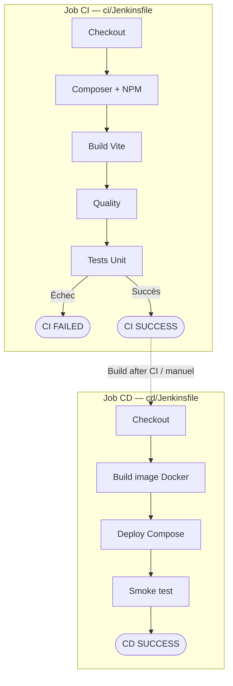
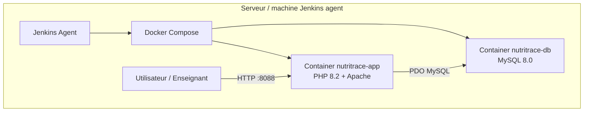
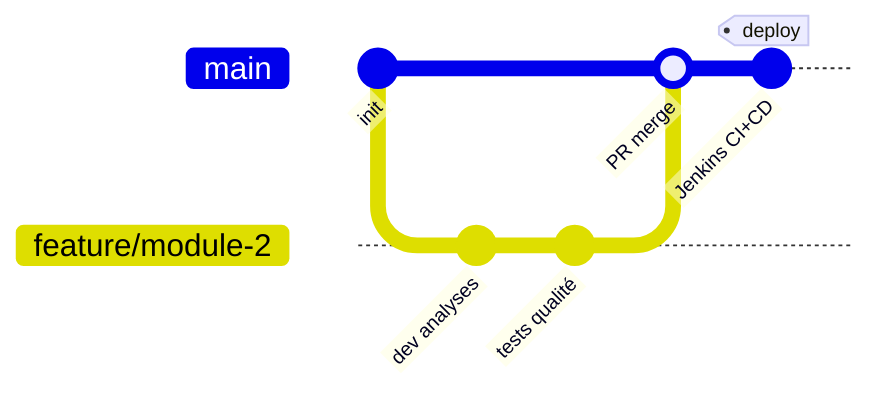

# Document DevOps — Projet NutriTrace

**Projet :** NutriTrace (plateforme de traçabilité agroalimentaire)  
**Stack :** Laravel 12 · PHP 8.2 · Vite · MySQL · Jenkins · Docker  
**Objectif :** Décrire le processus DevOps mis en place, du développement jusqu’au déploiement continu.

---

## 1. Introduction

La démarche DevOps de NutriTrace vise à **automatiser** la construction, le contrôle qualité et le déploiement de l’application, afin de :

- réduire les erreurs humaines lors des mises en production ;
- détecter rapidement les régressions (tests automatisés) ;
- garantir un environnement de déploiement **reproductible** (Docker) ;
- assurer une boucle courte entre le code produit par l’équipe et l’environnement cible.

L’outil d’orchestration choisi est **Jenkins**, couplé à **Git** (dépôt EspritHub) et **Docker / Docker Compose**.

---

## 2. Diagramme du processus DevOps

Le schéma ci-dessous présente le cycle complet mis en place pour NutriTrace.

```mermaid
flowchart LR
    subgraph DEV["1. Développement"]
        A[Développeur] --> B[Feature branch]
        B --> C[Commit & Push Git]
    end

    subgraph SCM["2. Gestion de code"]
        C --> D[(Dépôt EspritHub / Git)]
    end

    subgraph CI["3. Intégration continue — Jenkins"]
        D -->|Webhook / Poll SCM| E[Jenkins Pipeline]
        E --> F[Checkout]
        F --> G[Composer + NPM]
        G --> H[Build Vite]
        H --> I[Lint & config]
        I --> J[Tests PHPUnit]
    end

    subgraph CD["4. Déploiement continu"]
        J -->|Branche main OK| K[Build image Docker]
        K --> L[Docker Compose up]
        L --> M[Environnement cible]
    end

    subgraph OPS["5. Exploitation"]
        M --> N[Monitoring / logs]
        N -->|Feedback| A
    end
```



### Lecture du processus

| Étape | Acteur / outil | Description |
|--------|----------------|-------------|
| Développement | Équipe NutriTrace | Codage des modules (analyses, qualité, auth, etc.) sur des branches dédiées |
| Gestion de code | Git / EspritHub | Historique versionné, revue via Pull Requests |
| CI | Jenkins | À chaque push / merge : installation, build front, tests |
| CD | Jenkins + Docker | Si la branche `main` est verte : image Docker puis déploiement Compose |
| Exploitation | Serveur / containers | Application accessible ; retours vers l’équipe pour correction |

---

## 3. Pipelines séparés : CI et CD

CI et CD sont **volontairement séparés** (deux jobs, deux fichiers) :

| Job Jenkins | Fichier (Script Path) | Rôle |
|-------------|----------------------|------|
| **nutritrace-ci** | `ci/Jenkinsfile` | Intégration continue seule |
| **nutritrace-cd** | `cd/Jenkinsfile` | Déploiement continu seul |

### 3.1 Vue d’ensemble



### 3.2 Configuration Jenkins (SCM)

Créer **deux** jobs *Pipeline* → *Pipeline script from SCM* → même repo Git :

1. Job **nutritrace-ci** → Script Path = **`ci/Jenkinsfile`**  
2. Job **nutritrace-cd** → Script Path = **`cd/Jenkinsfile`**  

Option CD : *Build after other projects are built* → sélectionner `nutritrace-ci` (seulement si CI vert).

### 3.3 Étapes CI (`ci/Jenkinsfile`)

| Stage | Actions |
|-------|---------|
| Checkout | Code Git |
| Dependencies | Composer + NPM |
| Build assets | `npm run build` |
| Quality | Vérif Laravel |
| Tests | PHPUnit Unit |

→ **Aucun déploiement** dans ce job.

### 3.4 Étapes CD (`cd/Jenkinsfile`)

| Stage | Actions |
|-------|---------|
| Checkout | Code Git |
| Build image | `docker build` |
| Deploy | `docker compose up -d` (app + db) |
| Smoke test | HTTP sur le port 8088 |

→ Application : **http://127.0.0.1:8088**

---

## 4. Architecture de déploiement (Docker)



Fichiers associés :

- `Dockerfile` — image de l’application Laravel  
- `docker-compose.yml` — orchestration `app` + `db`  
- `Jenkinsfile` — automatisation CI/CD  

---

## 5. Flux Git recommandé (aligné DevOps)



1. Développement sur une branche `feature/...`  
2. Pull Request vers `main`  
3. Jenkins exécute la CI sur la PR / la branche  
4. Après merge sur `main`, Jenkins exécute CI **et** CD  

---

## 6. Mise en place Jenkins **dans Docker** (recommandé)

Jenkins tourne directement dans Docker Compose — pas d’installation Windows.

```bash
docker compose up -d --build jenkins
```

| Accès | URL / info |
|--------|------------|
| Interface Jenkins | **http://127.0.0.1:8090** |
| Login | `admin` / `admin` |
| Conteneur Docker Desktop | `nutritrace-jenkins` → bouton **Open in Browser** |
| Job préconfiguré | `nutritrace-ci-cd` (créé au démarrage) |

1. Lancer `docker compose up -d` (app + db + jenkins).  
2. Ouvrir Jenkins depuis Docker Desktop ou le navigateur.  
3. Se connecter (`admin` / `admin`).  
4. Ouvrir le job **nutritrace-ci-cd** → **Build Now**.  
5. Suivre les stages CI/CD dans la console.  

Le socket Docker est monté dans Jenkins : le pipeline construit et déploie les images via Docker.

---

## 7. Avantages pour le projet NutriTrace

- **Qualité :** les modules (analyses, qualité IA, auth, etc.) sont retestés à chaque intégration.  
- **Reproductibilité :** même stack via Docker, indépendamment de la machine locale.  
- **Traçabilité :** chaque build Jenkins est lié à un commit Git.  
- **Rapidité de livraison :** déploiement automatique dès que `main` est stable.  

---

## 8. Conclusion

Le processus DevOps de NutriTrace s’articule autour de **Git → Jenkins (CI) → Docker (CD)**.  
Le pipeline couvre l’installation des dépendances, la construction des assets, les tests automatisés, puis le déploiement conteneurisé sur l’environnement cible.  

Ce document, accompagné des fichiers `Jenkinsfile`, `Dockerfile` et `docker-compose.yml`, constitue le livrable DevOps à transmettre à l’enseignant avant la séance de validation finale.

---

## Annexes

### A. Emplacement des fichiers

| Fichier | Rôle |
|---------|------|
| `Jenkinsfile` | Pipeline déclaratif CI/CD |
| `Dockerfile` | Image applicative |
| `docker-compose.yml` | Déploiement multi-conteneurs |
| `docs/DevOps-NutriTrace.md` | Le présent document |

### B. Commandes utiles (manuel / agent)

```bash
# Tests locaux (équivalent étape CI)
composer install && npm install && npm run build
php artisan test

# Déploiement local (équivalent étape CD)
docker compose up -d --build
```

### C. Schéma synthétique (une page)

```
  [Dev] --push--> [Git EspritHub] --webhook--> [Jenkins]
                                                    |
                         +--------------------------+--------------------------+
                         |          CI              |           CD             |
                         |  deps → build → tests    |  docker build → compose  |
                         +--------------------------+--------------------------+
                                                    |
                                              [App NutriTrace + MySQL]
```
